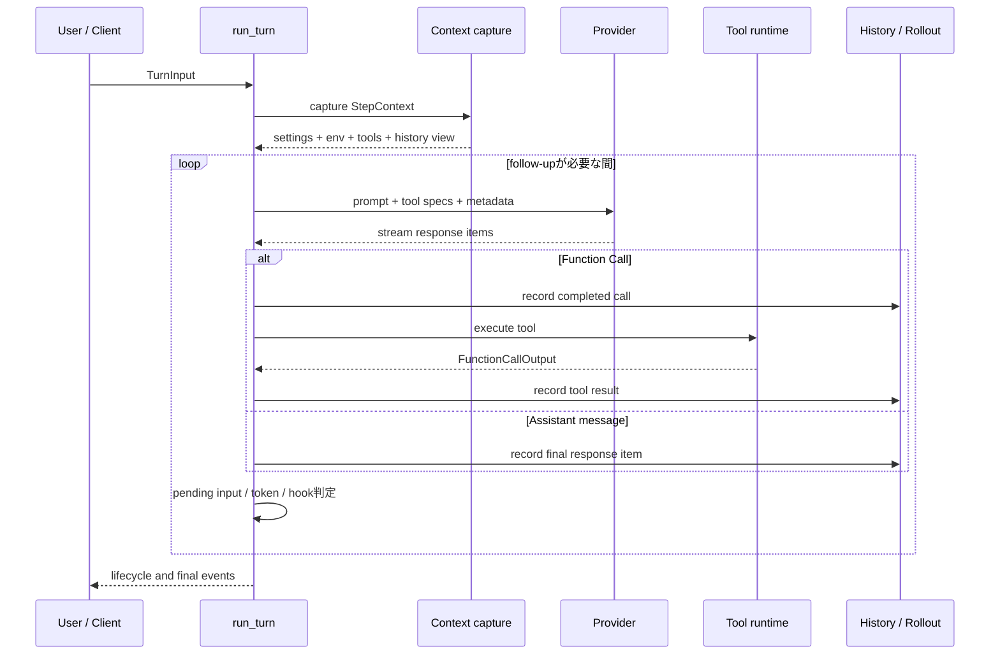

# チャットループ

## 役割

チャットループは、ユーザー入力を受け取り、必要なコンテキストとToolを準備し、ProviderへSamplingを行い、Tool実行が必要なら同じTurnの中で再びSamplingするオーケストレーターです。

中心となる関数は [`run_turn`](https://github.com/edge-m/codex-fork/blob/main/crates/core/src/session/turn.rs#L140) です。`run_turn` は「モデルへのリクエスト1回」ではなく、「ユーザーから見た1回のTurn」を所有します。

## まず、何が繰り返されるのか

モデルがAssistant messageだけを返せば、通常はそのTurnが完了します。Function Callを返せば、Toolを実行してその結果を会話履歴へ追加し、次のSamplingへ進みます。

## Turn開始前

`run_turn` は、いきなり新しいユーザー文をPromptへ追加しません。概念的には次の順序です。

1. 前のTurnから遅れて完了したHook結果をDrainする
2. Turn用の `ModelClientSession` を作る、またはPrewarm済みSessionを再利用する
3. 新しい入力を記録する前にPre-sampling Compactionを判定する
4. ユーザー入力に含まれるPlugin、Skill、MCP Serverの要求を解析する
5. 要求されたMCP/Pluginを含む最初の `StepContext` を捕捉する
6. World StateとEnvironmentの差分をモデル履歴へ反映する
7. Skill、Plugin、Extension由来の注入項目を履歴へ追加する
8. Session-start HookとTurn入力Hookを実行する
9. Hookが受理したあとでShell SnapshotなどのPrewarmを開始する

Pre-sampling Compactionが失敗した場合でも、受け取った入力を保持するための処理が入ります。入力を記録するタイミングは、単なるUI表示ではなく、Rolloutの耐久性と関係します。

## StepごとのSampling

Turnのループでは、次の処理を毎Step行います。

1. QueueにあるSteer入力を、Drain可能な状態なら取り込む
2. 入力に応じてMCP ServerとPlugin要求を再評価する
3. 現在の設定から不変の `StepContext` を捕捉する
4. 現在時刻Reminder、World State、Reasoning設定を更新する
5. Session履歴をモデルのInput Modalitiesに合わせてPrompt用に変換する
6. Response Metadataを作る
7. Prompt、Tool仕様、Base Instructions、Output Schemaを組み立てる
8. ProviderへStreaming Requestを送る
9. Streamを処理し、Response Itemを履歴・UIイベント・Tool実行へ分配する

Step Contextはリクエスト中に設定が変わっても、そのSamplingの間は固定です。これにより、モデルへ提示したTool仕様と実際に実行するTool、モデル設定、Environmentが同じSnapshotを参照します。

## Sampling後の判定

Samplingが終わると、`run_turn` は次の3つを確認します。

- Providerの出力がTool実行などのFollow-upを要求したか
- Queueに保留入力があるか
- Context Window / Auto CompactのToken状態が上限に達したか

Follow-upが不要ならStop Hookを実行します。Stop Hookが継続を要求し、追加Promptを持つ場合は、そのPromptを履歴に追加して同じTurnを続けます。

Follow-upが必要でToken上限にも近い場合は、現在の履歴をCompactしてから続けます。Compactは別の会話を始める処理ではなく、同じTurnの次のSamplingを成立させるためのContext Window管理です。

## 終了条件

通常の終了は、モデルが最終Assistant messageを返し、Tool Follow-upも保留入力もなく、Stop Hookも継続を要求しない場合です。ほかには次の終了があります。

- Cancellation Tokenがキャンセルされた
- `TurnAborted` など、ユーザーが中断した
- ProviderまたはTransportの再試行不能エラー
- Invalid Imageや入力制約エラー
- HookがTurnをブロックした
- CompactionまたはToolが致命的に失敗した

エラー時にも、すでに完了したResponse ItemやTool結果は記録済みの場合があります。表示イベント、履歴、Rolloutの順序を一緒に追うと、途中で失敗したTurnの状態を説明できます。

## 主なソース

- [`crates/core/src/session/turn.rs`](https://github.com/edge-m/codex-fork/blob/main/crates/core/src/session/turn.rs)
- [`crates/core/src/session/mod.rs`](https://github.com/edge-m/codex-fork/blob/main/crates/core/src/session/mod.rs)
- [`crates/core/src/session/step_context.rs`](https://github.com/edge-m/codex-fork/blob/main/crates/core/src/session/step_context.rs)
- [`crates/core/src/stream_events_utils.rs`](https://github.com/edge-m/codex-fork/blob/main/crates/core/src/stream_events_utils.rs)
