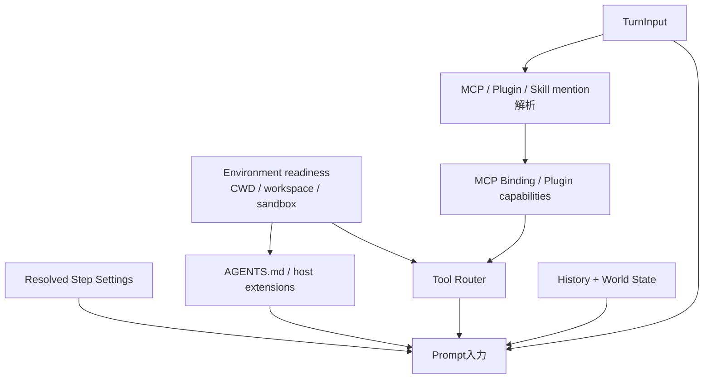

# チャット前のコンテキスト収集

## 何を「コンテキスト」と呼ぶか

ここでいうコンテキストは、単なる過去メッセージだけではありません。1回のSamplingを成立させるために、設定・環境・権限・Tool・拡張・履歴を組み合わせた `StepContext` と、そこから作るPrompt入力を指します。

`StepContext` は [`crates/core/src/session/step_context.rs`](https://github.com/edge-m/codex-fork/blob/main/crates/core/src/session/step_context.rs) で定義され、モデル設定、Token Budget、Telemetry、Environment、Capability Root、MCP Binding、Tool Router、`AGENTS.md` を束ねます。

## 収集される情報

| 情報 | 主な取得元 | 取得タイミング | モデルへの影響 | 永続化 |
| --- | --- | --- | --- | --- |
| Turn入力 | Client / TUI / Queue | Turn開始と各Follow-up | ユーザーメッセージまたはTool出力として見える | Rollout / 履歴 |
| Thread履歴 | SessionのContext Manager | 各Sampling直前 | Promptの過去入力になる | Rollout、SQLite Projection |
| Model設定 | `ResolvedStepSettings`、Model Catalog | 各Stepの開始時 | Model、Reasoning、Service Tierなどに反映 | Thread設定の一部 |
| Base Instructions | CoreのPrompt構築 | Sampling直前 | Developer/System相当の指示になる | 原文全体ではなく履歴項目になる場合あり |
| `AGENTS.md` | Agents MD Manager | Environment更新後、各Step | 指示としてモデルに注入される | 通常は外部ファイルが正規ソース |
| CWD / Workspace | Turn Environment | StepContext捕捉時 | Toolの実行対象、差分表示、Promptに影響 | Thread設定やRolloutのContext情報 |
| Git情報 | Environment / Git Utils | 起動・Thread更新・差分計算時 | World Stateや表示情報に反映 | Thread metadata / Rollout項目 |
| Permission Profile | Config / Session Settings | StepContext捕捉時 | Toolが実行できる範囲を制限 | Thread設定Snapshot |
| Sandbox Context | Executor Capability Discovery | Stepごと | Tool実行のファイル・Network境界になる | 通常は永続化しない |
| MCP Binding | MCP Manager | 入力中のMention解析後 | MCP Toolの仕様がPromptへ提示される | 接続状態・設定は別管理 |
| Plugin | Plugin Manager | 入力MentionとConfigから | Plugin Capabilityや注入Promptに反映 | Config / Plugin metadata |
| Skill | Skill Snapshot | 入力Mentionと依存解決時 | Skill指示や依存Toolが注入される | Skillファイルが正規ソース |
| Tool Router | `build_tool_router` | 各Step | モデルに公開するTool仕様と実行経路を決める | Tool Callは履歴へ保存 |
| Shell Snapshot | Shell Snapshot builder/cache | Hook受理後にPrewarm、必要時に取得 | コマンド実行の環境情報に使われる | 通常は一時状態 |
| World State | Session / Context Manager | Stepごとに差分確認 | ファイル状態やEnvironment差分を提示 | Rolloutに記録される |
| 添付・画像 | Attachment Store / Turn Input | 入力準備時 | Input modalityに応じてPromptへ入る | Attachmentと履歴 |
| Auth Snapshot | Provider Runtime | Turn admission / Request開始 | Provider内部のHeader・Credential選択に使う | Credential値はThreadに保存しない |
| 時刻 | Current Time provider | Sampling前 | Reminderやメタデータに反映 | 必要なイベントのみ |
| Telemetry | Session Telemetry | StepとProvider Request | モデルには見えない | Log / Metric / Trace |

## 収集の順序

重要なのは、すべてを一度だけ起動時に収集するわけではないことです。`run_turn` は入力が変わったとき、Tool実行後に次のStepへ進むとき、設定やEnvironmentが変わったときに、新しい `StepContext` を捕捉します。

## モデルに見えるものと見えないもの

モデルに見えるのは、最終的にPromptへ変換された履歴、指示、Tool仕様、Environment差分、ユーザー入力です。Credential値、内部のArc/Mutex、Telemetry、DB接続そのものはモデルに見えません。

ただし、権限やSandboxは「説明文」として見えるとは限りません。Tool実行が拒否される、利用可能なToolが限定される、パスがマスクされる、といった振る舞いとしてモデルに現れます。

## 主なソース

- [`crates/core/src/session/mod.rs`](https://github.com/edge-m/codex-fork/blob/main/crates/core/src/session/mod.rs): `capture_step_context_inner`
- [`crates/core/src/session/step_context.rs`](https://github.com/edge-m/codex-fork/blob/main/crates/core/src/session/step_context.rs)
- [`crates/core/src/context_manager/history.rs`](https://github.com/edge-m/codex-fork/blob/main/crates/core/src/context_manager/history.rs)
- [`crates/core/src/context/mod.rs`](https://github.com/edge-m/codex-fork/blob/main/crates/core/src/context/mod.rs)
- [`crates/core/src/tools/spec_plan.rs`](https://github.com/edge-m/codex-fork/blob/main/crates/core/src/tools/spec_plan.rs)
