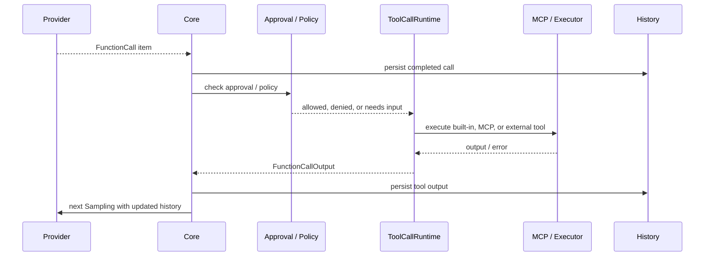

# Tool Loop

## Tool Loopとは

Tool Loopは、モデルがTool Callを出したときに「Toolを実行して終わり」にせず、結果を次のモデルInputとして返し、同じTurnを続ける流れです。

## 実行時に確定するもの

各Stepの `ToolRouter` が、モデルへ公開するTool仕様と、Callを実際に処理する経路を揃えます。ここには次が含まれます。

- built-in Tool
- Shell / Exec
- Apply Patch
- MCP Tool
- Plugin経由のTool
- Skillの依存Tool
- 現在のEnvironmentとPermission Profile

Toolの仕様がPromptに公開されていても、実行時にはApproval、Exec Policy、Sandbox、Network Policyを通ります。モデルからのCallは権限を直接与えるものではありません。

## 結果が次のPromptになるまで

1. StreamからFunction Callを認識する
2. Call Itemを履歴へ記録する
3. `ToolCallRuntime` が権限・引数・Environmentを確認する
4. 必要ならユーザーApprovalを待つ
5. ToolまたはMCP Serverを実行する
6. 成功・拒否・失敗を `FunctionCallOutput` にする
7. 結果を履歴とRolloutへ記録する
8. `needs_follow_up` を立てて、`run_turn` の次のループへ戻る

Toolが拒否された場合も、拒否理由をモデルへ返して次の判断をさせる場合があります。致命的な失敗はTurn Errorになります。

## 主なソース

- [`crates/core/src/stream_events_utils.rs`](https://github.com/edge-m/codex-fork/blob/main/crates/core/src/stream_events_utils.rs)
- [`crates/core/src/tools/parallel.rs`](https://github.com/edge-m/codex-fork/blob/main/crates/core/src/tools/parallel.rs)
- [`crates/core/src/tools/spec_plan.rs`](https://github.com/edge-m/codex-fork/blob/main/crates/core/src/tools/spec_plan.rs)
- [`crates/core/src/function_tool.rs`](https://github.com/edge-m/codex-fork/blob/main/crates/core/src/function_tool.rs)
