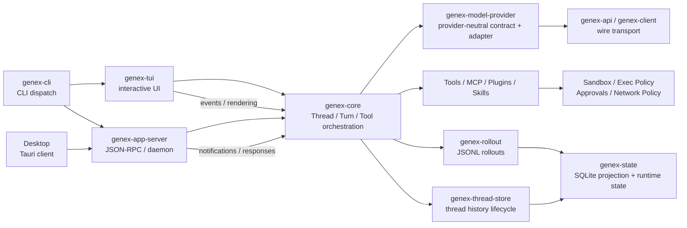

# システムマップ

Genexは単一の巨大な関数ではなく、入口・オーケストレーション・Provider・Capability・永続化・表示の境界を持つワークスペースです。

## 入口と責務

### CLI

[`crates/cli/src/main.rs`](https://github.com/edge-m/codex-fork/blob/main/crates/cli/src/main.rs) は引数解析とコマンドのディスパッチを所有します。チャットの内部動作そのものは所有せず、TUI・Exec・App Serverなど適切な実行経路へ委譲します。

### Core

[`crates/core/src/lib.rs`](https://github.com/edge-m/codex-fork/blob/main/crates/core/src/lib.rs) はThread、Turn、Context、Tool、Approval、Model Requestを組み合わせる中心です。「いつモデルへ問い合わせるか」「Tool結果をどう次の要求へ戻すか」はここで決まります。

### App Server

[`crates/app-server/src/lib.rs`](https://github.com/edge-m/codex-fork/blob/main/crates/app-server/src/lib.rs) はProtocol Requestを受けて、CoreのThread/Turn操作をクライアントへ公開します。Serverはモデルのプロンプトを組み立てる場所ではありません。

### Provider

[`crates/model-provider/src/contract.rs`](https://github.com/edge-m/codex-fork/blob/main/crates/model-provider/src/contract.rs) はProvider-neutralなRequest、Stream Event、Capability、Auth、Catalog、Usageの境界です。Provider固有のHTTP payloadやCredentialの詳細はadapter側に隠れます。

### 永続化

Rolloutは会話の追記記録、Thread StoreはThread lifecycle、Stateは検索・一覧・関係を高速化するSQLite Projectionを担当します。詳しくは [保存領域全体図](../storage/storage-map) を参照してください。

## 読むときの注意

クレート境界は責務の手がかりですが、実行順序を完全には表しません。例えばProtocol型は `protocol` クレートに定義されていても、Threadのライフサイクルを所有するのはCoreやApp Serverです。実際の振る舞いは、型定義と呼び出し側を一緒に追います。
