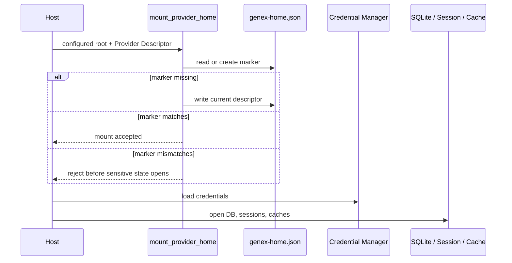

# Provider Home

## 何を守る仕組みか

Provider Homeは、SQLite、Rollout、Cache、CredentialがどのProvider Runtimeに属するかを固定する仕組みです。Rootのパスだけを設定しても、Markerが一致しなければ利用できません。

Markerファイルは [`genex-home.json`](https://github.com/edge-m/codex-fork/blob/main/crates/model-provider/src/home_marker.rs) です。秘密情報ではなく、Provider identityとProvider Protocol compatibility versionを持つ非秘密のメタデータです。

## 起動時の順序

不一致を検出した場合、既存のDBファイルがあっても、それを開いてから判断することはありません。Providerを変えたい場合は、別Runtimeと別Data Rootを使うのが基本です。

## Descriptor

Descriptorには、少なくとも次の境界情報があります。

- `provider_kind`
- `provider_protocol_version`

同じProvider種別でもProtocol互換Versionが異なれば、同じRootを安全に共有できない可能性があるため拒否されます。

## 主なソース

- [`crates/model-provider/src/home_marker.rs`](https://github.com/edge-m/codex-fork/blob/main/crates/model-provider/src/home_marker.rs)
- [`crates/app-server/src/runtime.rs`](https://github.com/edge-m/codex-fork/blob/main/crates/app-server/src/runtime.rs)
- [`crates/tui/src/lib.rs`](https://github.com/edge-m/codex-fork/blob/main/crates/tui/src/lib.rs)
