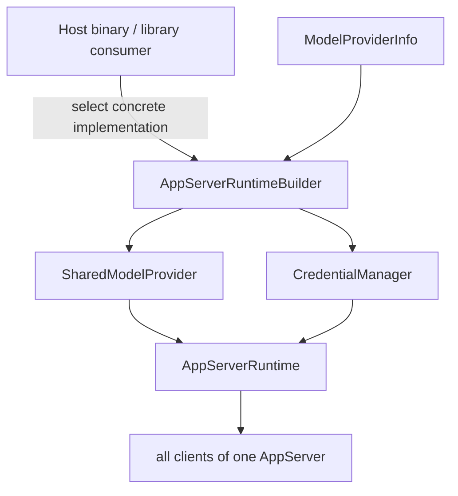

# AppServer RuntimeとProvider注入

現在の境界では、AppServer Runtimeが共有するProviderは1つです。ProviderをThreadやTurnのProtocol入力から切り替えるのではなく、Hostが具体的なProviderを構築してRuntimeへ注入します。

## 構築の流れ

[`AppServerRuntimeBuilder`](https://github.com/edge-m/codex-fork/blob/main/crates/app-server/src/runtime.rs) は、次の2つの入口を持ちます。

- Hostがすでに作った `SharedModelProvider` を `new` で注入する
- `ModelProviderInfo` からProvider adapterとCredential Managerを組み立てる

どちらの場合も、最終的な `AppServerRuntime` はProviderとCredential Managerを共有状態として保持します。Core、Model Catalog、Auth、Usageの各処理は、このRuntimeのProviderを参照します。

## 共有される状態

同じAppServerに接続したClientは、Providerの認証状態・Model Catalog・Usageの結果を同じRuntimeから観測します。Credentialが更新されると、新しいTurnは更新後の状態を使います。一方、実行中のTurnは開始時のCredential Snapshotを使って最後まで進みます。

この設計は、ThreadにProvider選択やCredentialを保存しないために重要です。Threadは「何を作業したか」を保存し、Runtimeは「どのProviderへ接続するか」を所有します。

## Provider Homeの境界

Runtime構築の前に [`mount_provider_home_for_runtime`](https://github.com/edge-m/codex-fork/blob/main/crates/app-server/src/runtime.rs) を呼び、Provider Descriptorを `genex-home.json` と照合します。

- Markerがなければ、現在のProvider Descriptorで新規作成する
- Markerが一致すれば、そのRootを利用する
- Provider種別またはProtocol Versionが不一致なら失敗する
- 不一致時にはCredential、SQLite、Session、Cacheを暗黙に開かない

この詳細は [Provider Home](../provider/provider-home) で扱います。

## 主なソース

- [`crates/app-server/src/runtime.rs`](https://github.com/edge-m/codex-fork/blob/main/crates/app-server/src/runtime.rs)
- [`crates/model-provider/src/contract.rs`](https://github.com/edge-m/codex-fork/blob/main/crates/model-provider/src/contract.rs)
- [`crates/model-provider/src/provider.rs`](https://github.com/edge-m/codex-fork/blob/main/crates/model-provider/src/provider.rs)
