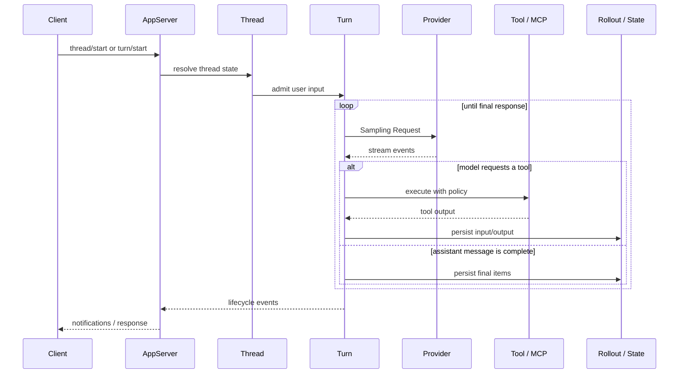

# 実行モデル

## まず全体を一文で言うと

Genexは、入口がCLI・TUI・Desktop・App Serverのいずれであっても、最終的には1つのRuntimeに接続されたCoreがThreadのTurnを進め、Providerへ複数回のSamplingを行い、Tool結果と履歴を保存しながらクライアントへイベントを返すシステムです。

## 実行単位

| 単位 | 寿命 | 主な責務 |
| --- | --- | --- |
| Process | OSプロセス全体 | 設定、Runtime、DB接続、トランスポートを保持 |
| AppServer | Serverプロセスまたはin-process server | Client Requestを受け、共有Runtimeへ委譲 |
| Runtime | AppServerに共有 | Provider、Credential、設定、State、サービスを束ねる |
| Thread | 会話・作業の継続単位 | 履歴、設定Snapshot、Rollout、環境の関係を保持 |
| Turn | 1回のユーザー依頼 | 入力受付から最終応答・エラーまで進行 |
| Step | 1回のモデルSampling | ContextをSnapshotし、StreamingとTool処理を完了 |

### 重要な境界

- AppServerは複数Clientから共有されます。
- Runtimeは1つのProvider実装を共有します。
- ThreadはProviderを選択する場所ではありません。
- Turn開始時に、モデル設定・認証・Environment・Tool構成の時点を捕捉します。
- Turn中のTool処理で追加のSamplingが発生しても、同じTurnに属します。

## 主なソース

- [`crates/core/src/session/turn.rs`](https://github.com/edge-m/codex-fork/blob/main/crates/core/src/session/turn.rs): TurnとStepの実行ループ
- [`crates/core/src/session/session.rs`](https://github.com/edge-m/codex-fork/blob/main/crates/core/src/session/session.rs): Sessionが共有する履歴・入力・サービス状態
- [`crates/app-server/src/runtime.rs`](https://github.com/edge-m/codex-fork/blob/main/crates/app-server/src/runtime.rs): Providerを注入したRuntimeの構築
- [`crates/app-server/src/request_processors/turn_processor.rs`](https://github.com/edge-m/codex-fork/blob/main/crates/app-server/src/request_processors/turn_processor.rs): ProtocolからTurn処理への接続
