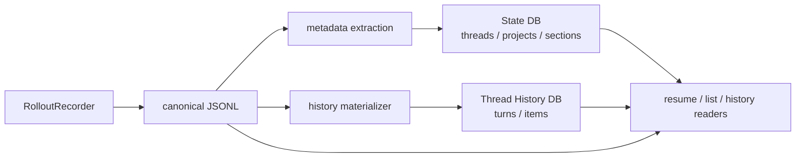

# Rollout JSONL

## Rolloutの役割

Rolloutは、Threadの会話・イベントを追記するJSONL記録です。 `sessions/` に通常のRollout、`archived_sessions/` にArchive済みのRolloutが置かれます。

[`RolloutRecorder`](https://github.com/edge-m/codex-fork/blob/main/crates/rollout/src/recorder.rs) は、Session Meta、Turn Context、Event、Response Item、World State、Token Usageなどの `RolloutItem` をCanonical JSONLとして書き込みます。

## 書き込みの3段階

```text
AppendItems
  -> 通常のTurn/EventをWriter Queueへ追加
Persist
  -> ThreadをRolloutとして耐久化できる状態にする
Flush
  -> それまでのQueueをディスクへ確定
```

実際のLocal Thread Storeは、耐久化されたJSONLを基準にしてからSQLite履歴Projectionを進めます。SQLite側のProjectionが失敗しても、Rolloutのほうが先に確定していれば、後で再Projectionできます。

## RolloutとState DBの関係

Rolloutの各ItemすべてがThread Metadataを更新するわけではありません。 `genex-state` の `apply_rollout_item` は、Session Meta、Turn Context、User Message、Token Count、Thread Settingsなど、一覧・検索に必要なItemだけを抽出します。

Thread History DBは、Rolloutを `thread_turns` と `thread_items` へMaterializeします。Projection Stateは「次にどのbyte offset / ordinalから読むか」を保持します。



## 圧縮と再開

Rolloutは圧縮される場合がありますが、参照されるRolloutを再度追記する前にはMaterializeされます。ResumeではRollout Prefix、Ordinal、Byte Offsetを使って必要な履歴を再構成します。

このため、Rollout File Name、Ordinal、Projection Offsetは単なるファイル名の詳細ではなく、ResumeとForkを支える永続化プロトコルです。

## 主なソース

- [`crates/rollout/src/recorder.rs`](https://github.com/edge-m/codex-fork/blob/main/crates/rollout/src/recorder.rs)
- [`crates/rollout/src/state_db.rs`](https://github.com/edge-m/codex-fork/blob/main/crates/rollout/src/state_db.rs)
- [`crates/thread-store/src/local/live_writer.rs`](https://github.com/edge-m/codex-fork/blob/main/crates/thread-store/src/local/live_writer.rs)
- [`crates/thread-store/src/local/thread_history_materialization.rs`](https://github.com/edge-m/codex-fork/blob/main/crates/thread-store/src/local/thread_history_materialization.rs)
- [`crates/state/src/extract.rs`](https://github.com/edge-m/codex-fork/blob/main/crates/state/src/extract.rs)
