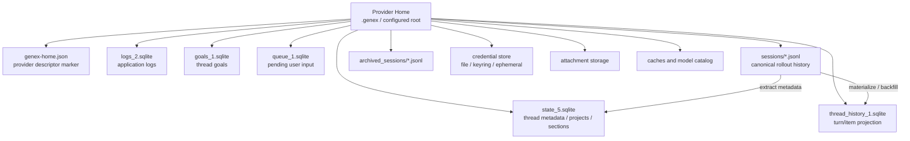

# 保存領域全体図

## 先に結論

Provider Home配下には、Runtimeが管理するSQLiteが5種類あります。ただし起動時に同じタイミングで5ファイルすべてを開くわけではありません。

## 記録の役割

| 保存領域 | 役割 | 正規記録か |
| --- | --- | --- |
| Rollout JSONL | ThreadのイベントとResponse Itemを追記する会話記録 | Yes |
| State DB | Thread一覧、メタデータ、Project、Section、関係、Attachment | Rolloutから再構築可能なProjectionを含む |
| Thread History DB | Turn/Itemのページングと履歴検索を高速化するProjection | Rolloutから再構築可能 |
| Logs DB | 検索・診断用のログ | No |
| Goals DB | Goalの現在状態と使用量 | Goal lifecycleの専用状態 |
| Queue DB | Turn中に受け付けた保留入力 | Queueの耐久化状態 |
| Credential store | Providerへ接続する秘密情報 | Threadの一部ではない |

## Provider Homeの意味

データルートは、単なるファイル置き場ではありません。 [`genex-home.json`](https://github.com/edge-m/codex-fork/blob/main/crates/model-provider/src/home_marker.rs) にProvider identityとProtocol compatibility versionを記録します。

起動時にMarkerを検証してからDB、Session、Cache、Credentialを開くため、同じディレクトリを異なるProvider Runtimeで暗黙に共有しません。

## 主なソース

- [`crates/state/src/sqlite.rs`](https://github.com/edge-m/codex-fork/blob/main/crates/state/src/sqlite.rs): SQLiteファイル名と接続設定
- [`crates/state/src/runtime.rs`](https://github.com/edge-m/codex-fork/blob/main/crates/state/src/runtime.rs): StateRuntimeの初期化
- [`crates/rollout/src/lib.rs`](https://github.com/edge-m/codex-fork/blob/main/crates/rollout/src/lib.rs): Rolloutディレクトリ
- [`crates/model-provider/src/home_marker.rs`](https://github.com/edge-m/codex-fork/blob/main/crates/model-provider/src/home_marker.rs): Provider Home Marker
